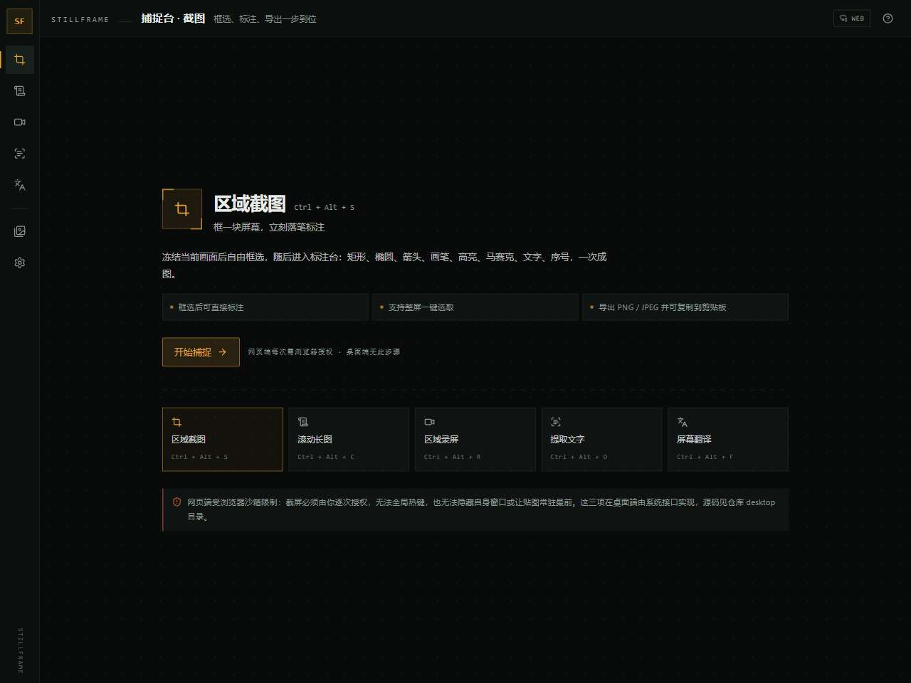

# 定格 · Stillframe

把「截一张屏」做成一套完整工具：**区域截图、滚动长截图、区域录屏、提取文字、屏幕翻译、标注编辑、贴图钉屏、自动保存**——一套界面，同时跑在浏览器、桌面壳、Android 壳里。

> 项目缘起：QQ 桌面端右键菜单里的截图模块（截图 / 录屏 / 长截图 / 提取文字 / 屏幕翻译 / 隐藏当前窗口 / 自动保存）用起来顺手，但它被锁在聊天软件里，跨端也不成立。这个仓库把那组能力独立实现成可自托管、可二次开发的开源应用。**界面规格不是凭空设计的**：工具顺序、调色板、滤镜名、文案、窗口尺寸逐项对照本机 QQ 9.9.38 的 `QQScreenShot` 资源包，证据与提取脚本见 [docs/QQ-PARITY.md](docs/QQ-PARITY.md) 与 `tools/qq-resource-probe.py`；仓库不含 QQ 的任何代码、图标或私有资源，全部逻辑重新实现。




---

## 目录

- [能力总览](#能力总览)
- [三端能力矩阵](#三端能力矩阵)
- [快速开始](#快速开始)
- [什么叫做智慧截图](docs/SMART-CAPTURE.md)
- [与 QQ 截图模块的对照](#与-qq-截图模块的对照)
- [目录结构](#目录结构)
- [核心实现](#核心实现)
- [快捷键](#快捷键)
- [隐私与数据](#隐私与数据)
- [已知限制](#已知限制)
- [路线图](#路线图)
- [贡献](#贡献)
- [许可](#许可)

---

## 能力总览

| 能力 | 说明 |
| --- | --- |
| 区域截图 | 冻结当前画面 → 拖拽自由选框 → 悬浮工具栏。带 QQ 同款 132×152 放大镜（117×84 取景 + 尺寸 + RGB 色号），双击快速完成、右键退出 |
| 标注编辑 | 七件套：矩形、椭圆、箭头、画刷、马赛克、文字、序号笔；12 色 QQ 原值调色板、1/3/7 三档线宽、模糊度、字号，悬浮工具条即点即用 |
| 滤镜 | 原图、日光海岸、LOMO、旧照片、黑白照、素描、经典LOMO、彩虹、铜版画、拍立得、日系甜美、黄昏，十二项名称照搬 QQ 滤镜栏 |
| 滚动长截图 | 逐屏「追加一屏」，行亮度签名自动找重叠；桌面壳支持自动滚动（向目标窗口注入滚轮，逐帧拼接，连续两帧无重叠即判到底），自身窗口压住选区时会自动隐藏再恢复；支持垂直/水平两个方向，命中失败可手动指定重叠 |
| 区域录屏 | 桌面壳由 Rust 抓帧线程按 30 帧抓选区，原始帧管道喂给 FFmpeg（rawvideo → libx264 CRF 20）直出 MP4，落在 `图片/Stillframe`；网页端仍是 canvas 裁切 + MediaRecorder（VP9/Opus 优先，只能 WebM）。录制中可用 QQ 录屏条那六件套（画刷/矩形/椭圆/箭头/文字/激光）标注，标注目前只合进网页端成片 |
| 提取文字 | tesseract.js 本地 OCR，识别引擎与中英语言包随站点内置（fast 版，中文包约 1.7MB），断网可用，结果可编辑后复制/导出；识别完会判读内容类型（正文 / 代码 / 表格 / 清单）并预选动作 |
| 屏幕翻译 | 原文/译文双栏；支持 OpenAI 兼容接口、DeepL、LibreTranslate 三种 provider |
| 贴图钉屏 | 截图钉在屏幕上，可拖拽、可缩放、可关闭（桌面壳内为真·置顶窗口） |
| 自动保存 | File System Access 直写指定目录；不支持时降级为逐次下载 |
| 图库 | IndexedDB 本地保存截图与录屏，缩略图网格 + 详情抽屉 |
| 隐藏当前窗口 | 桌面壳通过系统接口在截图前收起自身窗口，避免把自己拍进去 |
| 全局热键 | 桌面壳注册系统级快捷键；被其他截图工具占用时会在界面顶部点名「哪组键没抢到」并指向替代入口；网页端受浏览器限制，无全局热键 |
| 快捷浮窗 | 桌面壳的一条置顶动作条（截图/长图/录屏/取字/译屏），`Ctrl+Alt+Q` 呼出，主窗最小化也能用 |
| 延时截图 | 立即 / 3s / 5s；倒计时结束先收起自身窗口再抓帧，适合截右键菜单、下拉列表 |
| 窗口截图 | 从真实窗口列表里挑一个，整窗抓进来（含被遮挡部分），再进标注 / 取字 / 翻译 |
| 内网部署 | `deploy/` 提供 Docker Compose + 预热脚本，把网页版、识别引擎与语言包整体放到实训室内网，无需外网 |

## 三端能力矩阵

| 能力 | 网页端 (Web) | 桌面端 (Windows/macOS/Linux) | Android | iOS |
| --- | :---: | :---: | :---: | :---: |
| 区域截图 | ✅ 每次授权屏幕共享 | ✅ 系统截屏接口，免授权 | ✅ MediaProjection + 前台服务 | ⚠️ 仅相册导入 |
| 标注 / 导出 | ✅ | ✅ | ✅ | ✅ |
| 滚动长截图 | ✅ | ✅ | ✅ | ⚠️ 仅拼接相册图 |
| 区域录屏 | ⚠️ 网页端只能 WebM，30fps | ✅ 原生 30 帧直出 MP4（编码链已真跑，1080p 60 秒帧率待真机验收） | ⚠️ 原生抓帧约 3fps | ⚠️ 受限 |
| 提取文字 | ✅ | ✅ | ✅ | ✅ |
| 屏幕翻译 | ✅ 需自备 API Key | ✅ | ✅ | ✅ |
| 贴图钉屏 | ❌ 不能置顶 | ✅ 独立置顶窗口 | ✅ 悬浮窗（需授权） | ❌ |
| 隐藏自身窗口 | ❌ | ✅ | ✅（收起 Activity） | ❌ |
| 全局热键 | ❌ | ✅ | ❌（受系统限制） | ❌ |
| 自动保存目录 | ⚠️ 需浏览器支持 | ✅ 直接写盘 | ✅ SAF 目录 | ⚠️ |

图例：✅ 完整支持 · ⚠️ 支持但受平台限制 · ❌ 平台不提供该能力

平台做不到的部分不装作做得到：网页端每次截图都必须由用户点一次「共享屏幕」，浏览器不允许网页偷偷抓屏，也不允许网页注册全局热键、把自己窗口藏起来或让贴图置顶。这些在桌面壳与 Android 壳里由系统接口补齐，源码分别在 `desktop/` 与 `android/`。

## 快速开始

### 网页端

```bash
npm install
npm run dev        # http://127.0.0.1:24118
npm run build      # 产物在 dist/
npm run typecheck  # tsc --noEmit
```

第一次点「开始捕捉」时浏览器会弹出共享选择器，选要截的屏幕/窗口/标签页即可。刷新页面需要重新授权。

### 桌面端（Tauri 2）

前置：Rust 工具链（`rustup`，含 `cargo`）、Node 18+；Windows 另需 [WebView2](https://developer.microsoft.com/microsoft-edge/webview2/)（Win10/11 一般已内置）。

```bash
npm install
npm run build                 # 先生成前端产物 dist/
cd desktop
cargo tauri dev               # 开发
cargo tauri build             # 打包安装包
```

桌面壳直接复用 `dist/`（`tauri.conf.json` 里 `frontendDist` 指向 `../dist`），一套 UI 不改一行。

### Android 端

前置：JDK 17、Android SDK（compileSdk 34 / minSdk 26）、Gradle 8。

```bash
npm run build
# 把前端产物放进 WebView 的 assets
Copy-Item -Recurse -Force dist/* android/app/src/main/assets/www/
cd android
gradlew assembleDebug
```

Android 壳用 `WebView` 加载 `assets/www/index.html` 并注入 `AndroidBridge`，权限流程为：通知权限 → 屏幕录制授权（MediaProjection）→ 悬浮窗权限（可选）。

> **构建状态说明**：网页端 `tsc --noEmit` 零错误、`npm run build` 通过；`desktop/` 已在 Windows 上用 Rust 1.100 + MSVC 编译并真机验收（截图、窗口截图、取字、延时、快捷浮窗）；自动滚动代码完成但 20 屏样本未跑够；录制管线的编码侧已在 Linux 上真跑（90 帧合成画面 → h264 MP4，时长 3.000s、帧数 90 与输入吻合），1080p 60 秒真机帧率待 Windows 验收；`android/` 仍是未做编译验证的源码工程（本机无 JDK / Android SDK），首次构建若遇版本号或 API 变更，按报错调整依赖版本即可。

## 与 QQ 截图模块的对照

这套界面的每一项都不是"设计出来的"，而是从本机 QQ 9.9.38（QQNT）的 `QQScreenShot` 资源包里读出来再实现的：

```bash
# 只读，不碰 QQ 任何文件；输出可读的 XML/PNG
python tools/qq-resource-probe.py "C:\Program Files\Tencent\QQNT" -o ./qq-dump
```

- 工具条顺序、15 个按钮、tooltip 文案 → `QQScreenShot.rdb` 的 `ScreenCaptureWnd/CaptureToolbar`
- 12 色板色值（`#800000` / `#FB3838` / `#F7883A` …）→ `CameraPellette*Color` 按钮的 `Brush clrFrom`
- 12 个滤镜名、长截图方向条、录屏六件套、识图/翻译窗 540×440 → 同一份 XML
- 全部中文文案 → `Default.rdb` 的 `StringBundle`

逐项对照表、原始 XML 片段、以及"哪些照搬了、哪些只是近似、哪些没做"都写在 **[docs/QQ-PARITY.md](docs/QQ-PARITY.md)**。

## 目录结构

```
stillframe/
├─ src/                      # 前端（React + Vite + TS + Tailwind），三端共用
│  ├─ App.tsx                # 工作台布局与视图状态
│  ├─ components/            # Rail / TopBar / 选区层 / 编辑器 / 图库 / 设置 / 贴图
│  │  └─ panels/             # 长截图 / 录屏 / OCR / 翻译 四个模式面板
│  └─ lib/                   # 与 UI 无关的核心能力
│     ├─ capture.ts          # getDisplayMedia 开流、抓帧、抓选区
│     ├─ annotate.ts         # 八类标注的统一渲染（含马赛克）
│     ├─ stitch.ts           # 行亮度签名找重叠 → 长图拼接
│     ├─ recorder.ts         # 选区裁切 + 混音 + MediaRecorder
│     ├─ ocr.ts              # tesseract.js worker 单例
│     ├─ translate.ts        # 三种翻译 provider
│     ├─ storage.ts          # IndexedDB 图库
│     ├─ autosave.ts         # File System Access 自动保存
│     ├─ desktop.ts          # Tauri 宿主探测与命令桥
│     └─ image.ts / settings.ts / types.ts
├─ desktop/                  # Tauri 2 原生壳（Rust）
│  ├─ src/lib.rs             # capture_screen / pin_image / save_png / list_windows
│  ├─ tauri.conf.json        # 复用 ../dist，置顶贴图窗口
│  └─ capabilities/          # 权限声明（dialog / fs / global-shortcut）
├─ android/                  # Kotlin 原生壳
│  └─ app/src/main/java/.../ # MainActivity / CaptureService / 悬浮窗 / JS Bridge
├─ docs/
│  ├─ PLATFORM-MATRIX.md     # 三端逐项能力与平台限制的完整说明
│  └─ ARCHITECTURE.md        # 模块边界与数据流
└─ .github/                  # CI（类型检查 + 构建）与 issue 模板
```

## 核心实现

### 抓屏：一套抽象，三种来源

`capture.ts` 只认 `MediaStream`：网页端由 `getDisplayMedia` 拿到，桌面壳由 `capture_screen` 命令直接返回整屏 PNG（再转成 canvas）。拿到流之后统一走 `video → grabFrame / grabRegion`，所以选区、长图、录屏三条链路完全复用同一份代码。

### 长截图：为什么用行亮度签名

不用模板匹配（慢、对缩放敏感），而是把每一帧降采样成 32 列的灰度行签名，然后在 24–2400px 的候选区间里滑窗求平均绝对差，取最小且低于阈值（9）的偏移作为重叠高度。命中就按重叠高度拼，未命中按无重叠直接接并提示用户改手动重叠——宁可拼错让人看见，也不静默吞掉内容。

### 录屏：网页端在 canvas 里裁，桌面壳交给 FFmpeg

网页端 `RegionRecorder` 把整屏流每帧按选区 `drawImage` 到离屏 canvas，`canvas.captureStream(fps)` 得到裁切后的视频轨，再用 `AudioContext` 把系统声与麦克风混成一条音轨，交给 `MediaRecorder`——不依赖服务端，也不用装 FFmpeg，代价是只能出 WebM。

桌面壳改走原生：`start_recording` 起一个抓帧线程，`xcap` 按目标间隔抓选区，RGBA 原始帧直接写进 `ffmpeg -f rawvideo` 的 stdin，libx264 `veryfast` / CRF 20 编成 MP4。这样绕开了 WebView 里那条「轮询抓帧只有个位数帧率」的路，也让成片能直接播放和转发。结束时报实际帧数与掉帧，不粉饰。

FFmpeg 的查找顺序：命令参数 → 环境变量 `STILLFRAME_FFMPEG` → 应用目录（`ffmpeg.exe`、`sidecars/ffmpeg.exe`、`binaries/ffmpeg.exe`）→ PATH。都找不到时，点开始录制会直接报错退出，不会静默录出一段空文件。

编码这条链路可以脱离 GUI 单独验：`cargo run --manifest-path tools/recorder-check/Cargo.toml`——喂 90 帧合成画面给 FFmpeg，再用 `ffprobe` 核对编码、分辨率、帧数与时长；CI 里也有同名任务。

### OCR 与翻译都在本地做调度

OCR 用 tesseract.js 的单例 worker，换语言时 terminate 重建，避免 worker 泄漏。识别引擎（worker + WASM 核心）与中英 fast 语言包都随站点内置，主线程预取解压后写进 IndexedDB 给 Worker 命中，整条链路不依赖网络。翻译只做调度：请求发给你自己填的 provider（OpenAI 兼容 / DeepL / LibreTranslate），Key 存在本机 `localStorage`，不上传本项目任何服务器——本项目没有服务器。

### 桌面壳与 Android 壳的接法

前端 `desktop.ts` 探测 `window.__TAURI__.core.invoke`（Tauri 2）或注入的 `AndroidBridge`；探测不到就全部回落浏览器实现。判断逻辑集中在一处，UI 不需要关心自己跑在哪个壳里，只在「网页端限制」提示条上如实标注差异。

## 快捷键

| 动作 | 桌面端 | 网页端 |
| --- | --- | --- |
| 区域截图 | `Ctrl+Alt+S` | 点按钮（无全局热键） |
| 区域录屏 | `Ctrl+Alt+R` | 同上 |
| 滚动长截图 | `Ctrl+Alt+C` | 同上 |
| 提取文字 | `Ctrl+Alt+O` | 同上 |
| 屏幕翻译 | `Ctrl+Alt+F` | 同上 |
| 撤销 / 重做 | `Ctrl+Z` / `Ctrl+Shift+Z` | 同 |
| 复制到剪贴板 | `Ctrl+C` | 同 |
| 另存为 | `Ctrl+S` | 同 |

桌面端热键在 `desktop/src/lib.rs` 的 `register_shortcuts` 里注册，可在设置面板改键位（改完需重启壳）。

## 隐私与数据

- 截图、录屏、OCR 结果、翻译原文**全部在本机处理**，本项目没有后端，也没有任何埋点。
- 图库存在浏览器/壳的 IndexedDB 里；自动保存写你指定的目录。
- OCR 识别引擎与中英语言包默认随站点内置（fast 版），离线可用；设置里也可改填自托管语言包目录，追加日/其他语言。
- 翻译请求直接发给你配置的 provider，Key 只存本机。用第三方服务时，原文会离开本机——这是你自己选择的出口。
- 录屏音轨涉及麦克风时，浏览器/系统会单独弹权限，拒绝也能只录画面。

## 已知限制

- **桌面壳原生录制本轮先只录画面**。声音（WASAPI 环回 + 麦克风 48kHz 混音）与录屏标注进成片是下一批；要带声音/带标注的成片，先用网页端录 WebM。
- **网页端录屏只有 WebM**。浏览器 MediaRecorder 不支持直接出 MP4；要 MP4 请用桌面壳或在本地转码：`ffmpeg -i in.webm -c:v libx264 -crf 20 out.mp4`。
- **网页端每次抓屏都要重新授权**，这是浏览器安全模型的硬约束，不是 bug。
- **长截图的重叠识别依赖画面有横向纹理**。纯色/大面积渐变的页面可能识别失败，此时用面板里的手动重叠输入。
- **长截图自动滚动只在桌面壳可用**：它要向目标窗口注入滚轮事件，网页端没有平台级输入注入，请手动滚动后点追加。自动滚动目前只做竖向；`20 屏成功率 ≥90%` 这一项还没有在真机上跑够样本。
- **滤镜是参数近似**。QQ 用自家图像引擎，这里用 Canvas 的 `filter` + 压暗/着色近似十二种观感，同图不同机会有细微差别。
- **选框的 Alt 直线吸附未做**。QQ 按住 Alt 可把选区吸附成直线，这里只保留自由框选。
- **OCR 首次识别要等语言包就位**：内置包首次会从站点读入并写入 IndexedDB（约 3–4MB，一次性），之后走缓存；中文包 1.73MB 已随站点分发，不再从外网拉。
- **Android 10+ 录屏必须常驻前台服务通知**，系统强制，无法隐藏。
- **iOS 不做系统级抓屏**：Sandbox 不允许跨 App 读屏，仓库只保证「相册导入 → 标注 → 拼接」这条链路可用；未提供 iOS 工程。
- **多显示器与混合 DPI 仍按单屏假设处理**：选区、窗口、滚动注入点用的是同一套坐标，副屏或 125%/150% 混排时可能出现偏移。
- **android/ 未编译验证**（本机缺 JDK / Android SDK），见上文构建状态说明。

## 路线图

升级范围、技术方案、排期与验收口径见 **[docs/UPGRADE-PLAN.md](docs/UPGRADE-PLAN.md)**（同一内容的 Word 版在 `docs/Stillframe-升级项目书-v1.0.docx`）。当前排期：

- [ ] v0.2 可用性补齐（第 1–6 周）：桌面落盘、Alt 吸附与等比、贴图管理、识图段落（已完成主体，剩 E2E；见 [CHANGELOG.md](CHANGELOG.md)）
- [x] 长截图自动滚动（桌面壳注入滚轮 + 逐帧拼接 + 到底判定）
- [ ] v0.3 录制（第 7–14 周）：1080p30 录制直出 MP4
- [ ] v1.0 发布（第 15–20 周）：三端安装包、双语、性能与测试基线
- [ ] 标注支持图层顺序与自由变换
- [x] OCR 引擎与语言包内置、离线可用，语言包目录可改填自托管地址
- [ ] 图库导入/导出 `.stillframe` 归档

## 贡献

见 [CONTRIBUTING.md](CONTRIBUTING.md)。提交前请保证 `npm run typecheck` 与 `npm run build` 通过；涉及原生壳的改动请在 PR 里写明你验证过的平台与工具链版本。

## 许可

[MIT](LICENSE)。本项目为独立实现，与腾讯 / QQ 无关联，未使用其任何代码或资源；「QQ」「截图」等名称仅用于说明功能对标关系。
